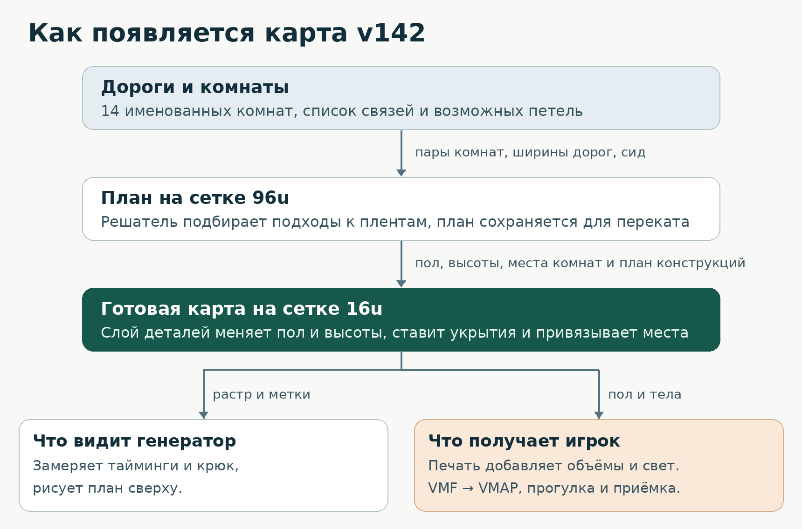
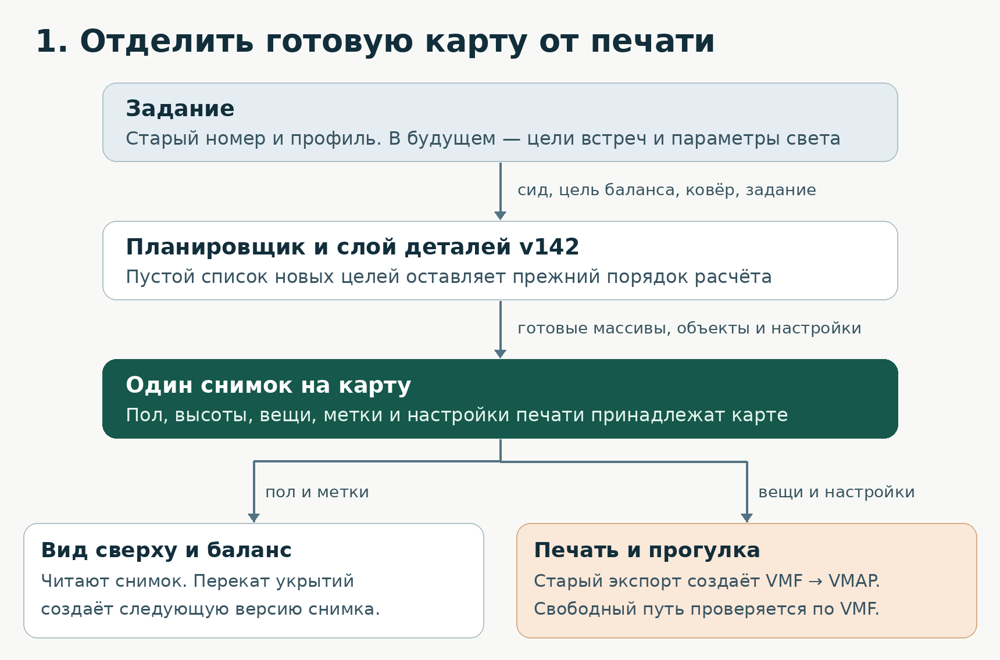
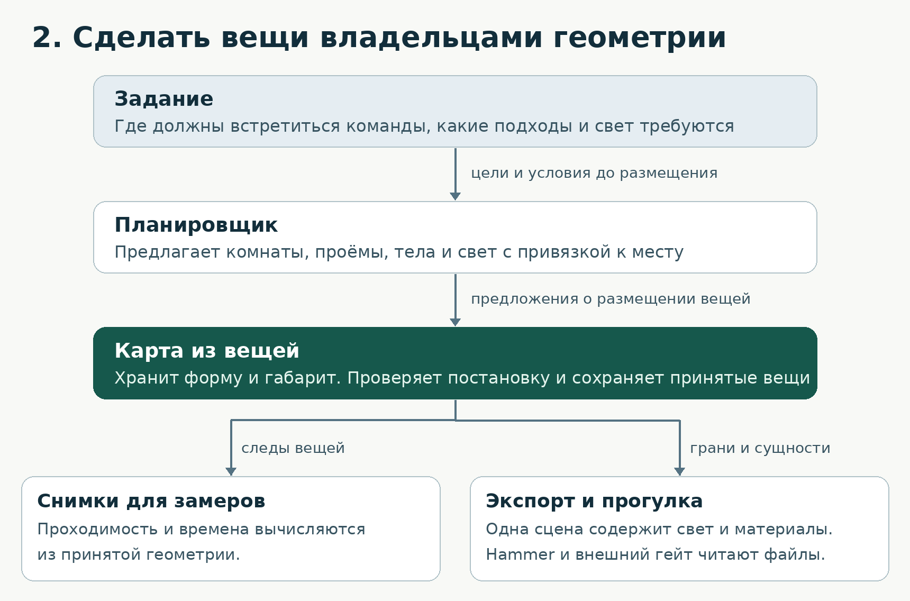

# Из чего строить карту Изохроны

**Предлагаю вариант 1, если старый номер обязан открывать карту байт в байт.** Можно отделить готовую карту от вкладки и печатать из одного снимка. На четырёх старых номерах совпали все восемь файлов VMF и VMAP. Вариант 2 даёт более сильную гарантию для новых карт — одна и та же дверь задаёт проход для игрока, замера и экспорта. Для этого придётся перенести в вещи геометрию, которая сегодня рождается при печати.

**Цена выбора видна на одном маршруте.** На карте `1712084959:2:2164811388` от B Stack до B Long растр показывает почти прямой путь, а печать — обход ×5,22. Вариант 1 сохраняет и эту особенность старой карты. Вариант 2 позволит отвергнуть такую постановку до выдачи карты, если замер по вещам учитывает объём игрока и высоты. [Числа и SHA-256](arch-research/snapshot.json)

[Вариант 1 · снимок](#snapshot) [Вариант 2 · вещи](#objects) [Цифры пробы](#probe)

## Как устроено сейчас



У карты два практически важных владельца. **`cur` во вкладке** держит план и детали, по которым считаются времена. **`buildVMF`** решает, какие физические объёмы и сущности попадут игроку. Внешний гейт меряет построенный файл. Масштаб сетки, профиль и флаги живут также вне `cur`. `useCur()` восстанавливает размеры перед чтением. [run и generateBalanced](../src/15_pokazaniya_balans.js#L239) · [cur и useCur](../src/13_risovanie.js#L3) · [buildVMF](../src/16_vmf.js#L2) · [разбор VMF](../tools/krjuk.py#L93)

<details><summary>Семь представлений и места в коде</summary>

Если считать отдельно форму данных, которую одна стадия передаёт следующей, получаем **семь представлений**. Шесть встречаются на обычном пути от кнопки генерации до VMAP. Седьмое, огрублённая копия решателя, нужно в экспериментах с мелким входом. Локальные рабочие маски и поля расстояний в это число не входят.

| Представление | Кто создаёт и кто читает |
|---|---|
| 1. Граф комнат и дорог | `baseNodes()` задаёт **14** именованных комнат. `makeEdges()` возвращает **19** дорог между **13** разными концами при каждом выборе открытого плента. `build()` вырезает все 14 комнат и дополнительно разыгрывает семь возможных рёбер `OPT`. Такой список уже есть в первом импорте v91. Комментарий v140 с числами «13/18» и откатом шести новых петель — историческая запись. В той пробе ширина ротации A↔B упала с 448 до 208u. [baseNodes и makeEdges](../src/10_yadro.js#L231) · [build, OPT](../src/10_yadro.js#L559) · [архивный v91](../builds/arhiv/izohrona_v91.html) |
| 2. План 96u | `generateOneCore` подбирает ширины подходов и передаёт в `generateBalanced` клетки пола `g`, высоты `zfield` и положения комнат `px`. Туда добавляются конструкции и укрытия. При перекате `recoverBodies` снова берёт этот план из `cur.__coarse`. [generateOneCore](../src/11_planirovshchiki.js#L387) · [generateBalanced и recoverBodies](../src/15_pokazaniya_balans.js#L222) |
| 3. Рабочая карта 16u | `detRefine` разворачивает 1 клетку в 6×6, меняет стены, проходы и высоты, расставляет тела и якоря мест. Полный `cur` содержит и объекты, и зоны. `buildDetail` пересчитывает времена по мелкому растру. Для `dust2` в пробе план 46×54 дал 276×324 клетки. [buildDetail](../src/15_pokazaniya_balans.js#L200) · [detRefine](../src/14_detali_profili.js#L96) · [размеры карт в пробе](arch-research/snapshot.json) |
| 4. Копия для быстрого замера | В `measureBalance` при `SC>1` крупная клетка считается полом от 34% заполнения блока, высота усредняется. При `SC=1` функция сразу зовёт `measure`. На обычной карте итоговый мелкий баланс считается прямым `measure`. У `coverAtCell` есть собственная временная маска для расстановки с порогом 70%. [applyMode, coverAtCell и measureBalance](../src/11_planirovshchiki.js#L317) · [buildDetail](../src/15_pokazaniya_balans.js#L200) |
| 5. Физическая печать VMF | `buildVMF` строит пол и объёмы, добавляет проёмы, рамы, пилястры, спавны и свет. Режет пересекающиеся коробки. Из поверхности `SURF` и занятых объёмов получает собственную оценку проходимости. Выход — текст VMF с брашами и сущностями. [buildVMF, SURF](../src/16_vmf.js#L398) · [рамы](../src/16_vmf.js#L1243) · [сверка после печати](../src/16_vmf.js#L2104) |
| 6. Сцена для потребителей | `vmfToScene` читает плоскости напечатанного VMF, восстанавливает вершины, грани, UV и сущности. Её читает прогулка для столкновений и изображения, а также конвертер VMAP. [vmfToScene](../core/vmf2vmap.js#L111) · [ПРОГУЛКА.открыть](../src/19_progulka.js#L343) |
| 7. Файл VMAP | `toVmap` пишет меши и сущности по образцу Hammer с детерминированными ID. Кнопка VMAP в поставке вызывает цепочку `buildVMF → vmfToVmap → toVmap`. В неё входят `kv2`, шаблон и таблица размеров текстур. [downloadVMAP и сборщик](../tools/sobrat.js#L24) · [toVmap](../core/vmap.js#L204) |

</details>

**Где рождается баланс.** `measure()` запускает поиск пути от T и CT к A, B и миду и от A к B для ротации. Так заданы пять опорных точек. `run()` передаёт целевые времена, разброс, вертикаль и кольца. Зоны назначает `computeZones`, места выделяет `computePlaces` по уже вырезанному полу. Изменение формы сегодня может изменить список мест. [measure](../src/10_yadro.js#L770) · [run](../src/15_pokazaniya_balans.js#L317) · [computePlaces и computeZones](../src/12_struktury_materialy_mesta.js#L319)

<details><summary>Флаги и режимы после загрузки v142</summary>

В таблице приведены значения после `bake()` и `applyProfile('dust2')`. Например, в начале файла `PALACE=false`, но `bake` посылает событие `change`, которое выставляет `true`. [bake и привязки режимов](../src/17_interfeys.js#L92) · [обработчики панели](../src/15_pokazaniya_balans.js#L330)

| Область | Включено или выбрано по умолчанию | Выключено или доступно как альтернатива |
|---|---|---|
| Планировщик | `MODE='corridor'`, план 96u, `DET.on` для слоя 16u | `MODE='partition'` строит объёмы, `MODE='shapes'` строит сразу на сетке 16u 258×288. `V95.fine` и эксперимент переноса `V95.fastSolve` выключены. [applyMode, generateOne и generateOneCore](../src/11_planirovshchiki.js#L330) |
| Геометрия, зоны | `ISLAND`, `PALACE`, `RAMPS`, `THRU`, `DOORS`, `DECOR`, `LMARK`, `ZONELIGHT`, `V92.zones14`, `V92.audit` | `FINEW`, `V92.door`, `V92.turn`, `V94.inner`, `V94.uneven`. `DOORS` включает конструкцию дверей при печати, `V92.door` — эксперимент планировщика. [bake](../src/17_interfeys.js#L121) · [обработчики](../src/15_pokazaniya_balans.js#L361) · [V92](../src/11_planirovshchiki.js#L22) |
| Проходы слоя деталей | `DET.door`, `zonewall`, `part`, `cover`, `narrow`, `voidfill`, `shot`, `stepfix`, `deadend`, `lmark`, `cutdead`, `tier`, `seal`, `thickwall`, `deadplace`, `сшивка` | `DET.wall`, `проруб`, `spawnwall`. [DET и detRefine](../src/14_detali_profili.js#L16) |
| Профиль и текстуры | `dust2` задаёт размер, ширину, вертикаль и цели деталей. `V79.pal` выбирает зонную палитру. `V127.fit=true`, `unit=64`, `want=96`, `V140.борта=true`, `V132.plain=true` | `mirage`, `inferno`, `ancient`, `cache`, `tuscan` доступны в панели. `V127.all=false` оставляет подгонку всех граней выключенной. `PALMODE='paint'` используется ниже по цепочке выбора палитры. [applyProfile](../src/14_detali_profili.js#L74) · [matOf](../src/12_struktury_materialy_mesta.js#L269) · [V127–V140](../src/10_yadro.js#L182) · [fitAx](../src/16_vmf.js#L59) |
| Встроенные переключатели конструкций | `V61.coverH/trim/core/corePerm/rise`, `V63.anchor/pair/arch/archW3/trim06`, `V64.noblock/sober/decor/fixtures`, `V65.stone/bulb/varycov/beams`, `V66.facade/backdrop`, `V70.sky/cornice/terrace/city/roofslab`, `V71.throat/connect/fitrot`, `V71F.fill`, `V72.clipLid/variety/routeGuard`, `V75.swallow`, `V79.smooth/accent/steps`, `V81.radar/ladder`, `V83.site` | `V61.narrow`, `V65.sconce`, `V70.balcony` имеют значение `false`. Условие конкретного прохода или палитры может ограничить эффект включённого флага. [объявления V61–V83](../src/10_yadro.js#L47) · [makeCover](../src/11_planirovshchiki.js#L421) · [buildVMF](../src/16_vmf.js#L2) |
| Отладка | В обычной вкладке ручки приборов не заданы | `DETOFF=сшивка,part` у `povtor` гасит перечисленные проходы. `БЕЗ` отключает эмиттер, `__TAGBOX` записывает источник коробки. `__SEED/__AIM/__COVSEED` задаются прибором или действием «открыть номер». [povtor, цикл карт](../tools/povtor.js#L31) · [НОМЕР.открыть](../src/18_nomer_karty.js#L46) |

</details>

## Где два источника правды

**Пол совпал, проход разошёлся.** У всех четырёх карт `__surf.расходятся=0`. На известной карте это 36 009 клеток пола. На одной паре B Stack → B Long печать закрыла две позиции кратчайшего растрового пути. После этого обход вырос с ×0,99 до ×5,22. Волна считает диагональный шаг за единицу, а прямую — через `hypot`, поэтому первое число может быть меньше единицы. Высота пола и свободный объём над ним — два разных измерения. Правило §5 прямо требует сверки. [Числа по паре](arch-research/snapshot.json) · [buildVMF, сравнение двух сеток](../src/16_vmf.js#L2228) · [CLAUDE.md, §5](../CLAUDE.md#L332)

**Приборы смотрят на разные препятствия и якоря.** `detRefine` берёт якоря `ax/ay` и считает максимум по полу и по полу с высокими телами. `buildVMF` сравнивает растр и напечатанные препятствия для одной пары. `krjuk.py` заново разбирает файл, берёт `origin` сущностей `env_cs_place` и строит граф опор с запасом под рост игрока. Есть ещё отдельный расчёт `крюкГен` в экспортере гейта — он берёт `x/y` мест. Поэтому проверять согласие лучше на одной паре с одинаковой привязкой. Гейт сравнивает максимумы и число плохих пар с порогами, точного равенства между приборами он не требует. [detRefine](../src/14_detali_profili.js#L1933) · [крюкГен](../tools/gate_export.js#L33) · [разбор](../tools/krjuk.py#L93) · [сетка ходьбы](../tools/hodba.py#L34) · [пороги](../tools/priyomka.py#L27)

**Свет и текстуры проходят ещё одну границу.** Экспорт решает, куда поставить подвес и его лампу. `entProps` повторяет перевод солнца и пропуск `brightness_lumens` у `light_omni2` по наблюдениям в Hammer. `sverka_vmap` вручную подготовленные импорты сравнивает с результатом конвертации по форме мешей, материалу и UV. Новая настройка света, записанная только на одном конце цепочки, может потеряться на другом. [buildVMF, fixture и omni](../src/16_vmf.js#L1756) · [entProps](../core/vmf2vmap.js#L89) · [сверка с Hammer](../tools/sverka_vmap.js#L1)

## Варианты

<a id="snapshot"></a>

### 1. Отделить слой готовой карты



| Вопрос | Последствие выбора |
|---|---|
| Что переносится? | Все действующие стадии планирования, CSG, UV, конвертер VMAP, приборы и пороги. Потребуется собрать явные входы печати в снимок и передать его потребителям. Для переката нужен сохранённый крупный план. Печать пока по-прежнему добавляет физические объёмы. |
| Как задать горячую точку? | Перед `generateBalanced` в задание поступает список пар маршрутов и желаемых мест встречи. Планировщик должен читать его при выборе связей или при сравнении кандидатов. Одно описание интересной точки в готовом снимке даст только измерение. У старых номеров список пуст. |
| Как добавить свет или вещь? | Настройку света хранить в снимке вместе с источником, вещь — с положением, габаритом и материалом. Понадобится расширить действующий эмиттер и проверить перевод сущности в VMAP. Для вещи, перекрывающей путь, потребуется согласовать габарит с растровым замером. Здесь остаётся двойная работа. |
| Та же ли карта? | Для старых номеров требовать совпадения обоих файлов, включая порядок брашей, UV, сущностей и ID. Проба ниже проверяет это на настройках `dust2`. Новое задание с целями встречи может выбрать другую планировку. |

<a id="objects"></a>

### 2. Строить пол и проходы из вещей



| Вопрос | Последствие выбора |
|---|---|
| Что переносится? | Есть класс `Карта` с помещениями и стенами, проём со ссылкой на стену, ящик с рамой, правила просвета и `снимок(8)`. Сохраняются запись VMAP, данные текстур, внешний VMF-гейт и пороги. Для полной карты придётся выразить в вещах действующий планировщик, перепады и верхние пути, укрытия, зоны, формирование граней и UV. `core/vmf.toVmf` печатает пробный набор коробок. Паритет его UV и порядка с `buildVMF` требует отдельной проверки. [Карта](../core/yadro.js#L29) · [снимок](../core/yadro.js#L197) · [toVmf](../core/vmf.js) · [toVmap](../core/vmap.js#L204) |
| Как задать горячую точку? | Хранить встречу в задании до постановки комнат. По ней предложить места входов и связи, затем проверить времена по принятой геометрии. Для этого нужен новый планировщик и согласованный владельцем смысл «встречи». |
| Как добавить свет или вещь? | Добавить тип вещи с формой, допустимым размещением и геометрией. Привязать свет к вещи или месту и выводить сущность по типу. Сейчас в `chernovik.js` солнце и небо дописываются при сборке `scene`, а `снимок` видит двумерный след даже у приподнятого предмета. Для высоты, потолка и перекрытий придётся расширить снимок. [сцена черновика](../tools/chernovik.js#L49) · [геометрия и снимок](../core/yadro.js#L147) |
| Та же ли карта? | У нового планировщика даже тот же сид даст другие формы, расход случайных чисел и порядок брашей. Старые номера можно обслуживать сохранённым v142. Для перехода с требованием равных байтов опорой остаётся вариант 1, пока оба SHA не совпадут. Раздельный выбор версии для новых карт потребовал бы решения владельца. |

У черновика уже есть проверяемый результат. Пересборка двух комнат и коридора дала те же `chernovik_1.vmf` и `chernovik_1.vmap` при прямом `cmp`. Два проёма по 112u прошли, проём 64u отвергнут, ящик со щелью 56u придвинут. Игрок доходит до всех трёх помещений при проверке прохода 96u. Получилось 124 коробки, 5 сущностей, `vmapcheck` разобрал 125 мешей с 0 ошибок. Это проверка небольшого плоского участка. [Черновик для Hammer](../proby/chernovik_1.vmap) · [сценарий](../tools/chernovik.js#L23) · [проверка файла](../tools/vmapcheck.py)

<a id="probe"></a>

## Дешёвая проба и граница решения

**Риск варианта 1** — печать незаметно зависит от состояния вкладки, которого нет в снимке. Проба вводит номера через поле панели, скачивает VMF и VMAP обычными кнопками и делает независимую глубокую копию входных массивов и объектов вместе с размером клетки и флагом подгонки текстур. После открытия другой карты передаёт копию существующему `buildVMF`, а результат — существующему конвертеру. Это экспериментальный вызов через хук. Исходные файлы с кнопок, включая все байты текстур и сущностей, сравниваются по SHA-256. [Код пробы](../proby/arch-snapshot.js) · [полные отпечатки](arch-research/snapshot.json)

| Номер v142 при настройках dust2 | Крюк по деталям | Крюк печати | Крюк из файла VMF | Маршрутов уже 96u | Файлы со снимка и с кнопок |
|---|---:|---:|---:|---:|---|
| `327306348:4.007582529757321:855372152` | 2,27 | 2,04 | 2,00 | 20 | оба SHA совпали |
| `1977468515:3.277789574832176:2996074336` | 2,13 | 2,13 | 1,97 | 33 | оба SHA совпали |
| `3904671571:3.9450395249503933:3516158308` | 1,91 | 1,91 | 1,72 | 9 | оба SHA совпали |
| `1712084959:2:2164811388` | 2,88 | 5,22 | 3,71 | 36 | оба SHA совпали |

В таблице указан максимальный **найденный** крюк в каждой модели ходьбы. На последней карте из файла для шести пар путь вовсе не найден, а по печати у одиннадцати пар крюк хуже ×2. У трёх карт гейта скачанные VMF также совпали с SHA исходных файлов, снятыми до эксперимента. Соседний сценарий — переключение этой же проблемной карты из 2D в 3D. Отрицательный контроль — снимок с подменой одного `V127.fit` меняет SHA VMF с `7e55e666…` на `6e1831ba…`. Замеры выполнены на одном профиле с его остальными флагами. Перенос всех настроек и других профилей остаётся открытым. [Показания по файлам](arch-research/krjuk.txt) · [полные SHA](arch-research/snapshot.json) · [кадр 2D](arch-research/map-2d.png) · [кадр 3D](arch-research/map-3d.png)

**Номера и откат.** Сохранением карты в v142 служит текст `сид:цель:ковёр` с необязательным суффиксом отличающихся настроек. Цель сохраняется, поскольку решатель использует снос из предыдущих генераций вкладки. `localStorage` прогулки содержит чувствительность и качество. Для варианта 1 снимок нужен в памяти, старый номер открывается прежним маршрутом, при возврате к v142 его можно заново ввести. Для варианта 2 нужна явная привязка будущих номеров к версии планировщика, иначе старые карты потеряют воспроизводимость. [НОМЕР.код и открыть](../src/18_nomer_karty.js#L19) · [generateBalanced](../src/15_pokazaniya_balans.js#L239) · [настройки прогулки](../src/19_progulka.js#L30)

### Приёмка среза

| Критерий | Результат |
|---|---|
| 1–2. Представления, режимы, доказательство расхождения | **PASS.** Выполнен подсчёт графа и замер одной и той же пары на плохой карте. Замер по файлу проведён отдельно для всех четырёх карт. |
| 3. Варианты и схемы | **PASS.** Два варианта с последствиями для входов, экспорта и старых номеров. Понятность рисунков и выбор варианта — решение владельца. |
| 4. Проба интерфейса | **PASS.** У всех четырёх карт совпали VMF и VMAP, контроль поймал подмену настройки, ошибок страницы 0. |
| 5. Исходники и гейт | **PASS** для источников и продукта. Проверка сборки из 14 частей дала байтовое равенство. **FAIL** для зелёного гейта. Полный прогон на исходном коде занял **202,841 с**, максимум 22 маршрута уже 96u. При выборе трёх исходных номеров теми же приборами и порогами единственный красный результат — **33 при допустимом 0**. Проверка кнопок, текстур, спавнов и остальных порогов прошла. [Протокол штатного гейта](arch-research/gate-baseline.txt) · [протокол на фиксированных номерах](arch-research/gate-fixed.txt) |
| Проверка в Hammer / CS2 и новые горячие точки | **НЕ ПРОВЕРЕНО.** В этой пробе наблюдались браузерный интерфейс и файлы. Нового генератора или правил встречи в срезе нет. |

### Как воспроизвести

Открыть [продукт v142](../builds/izohrona_v142.html) в Chromium, в разделе «открыть карту по номеру» вставить полный номер из таблицы и нажать Enter. Для известной карты кадры сняты после обычных действий «Скачать .vmf», «Скачать .vmap» и включения «3D-превью».

Из корня проекта с зависимостями из `package-lock.json` и браузером Playwright выполнить команды ниже. Проба сохраняет исходные VMF, два кадра и SHA-256 в `out/arch-research`. В среде с общим установленным Chromium путь к его каталогу задаёт `PLAYWRIGHT_BROWSERS_PATH`.

```sh
node tools/sobrat.js --сверить builds/izohrona_v142.html
node proby/arch-snapshot.js
python3 tools/krjuk.py out/arch-research/*.vmf
node tools/povtor.js builds/izohrona_v142.html --сид 1712084959:2:2164811388
bash tools/priyomka.sh builds/izohrona_v142.html 3
```

Штатный `priyomka.sh` выбирает случайные номера. Для приложенного полного фиксированного прогона во временной копии запуска `gate_export` перед каждой генерацией подставили тройку из исходного `gen.json` и выбрали отдельный каталог VMF. Состав тестов, Python-приборы и пороги совпадают со штатными. Три исходных SHA записаны в пробу, поэтому она воспроизводит байтовую сверку и число узких маршрутов независимо от случайного гейта. [gate_export](../tools/gate_export.js#L20) · [priyomka](../tools/priyomka.py#L110) · [эталоны](../proby/arch-snapshot.js#L12)

Для отказа от среза достаточно вернуться к базовому `84bed46`. Продукт, исходные инструменты и формат номера в этом исследовании взяты из этой базы. Решение владельца — выбрать вариант 1 для совместимости со старой печатью, вариант 2 для новых карт из вещей либо указать правки к схемам.
