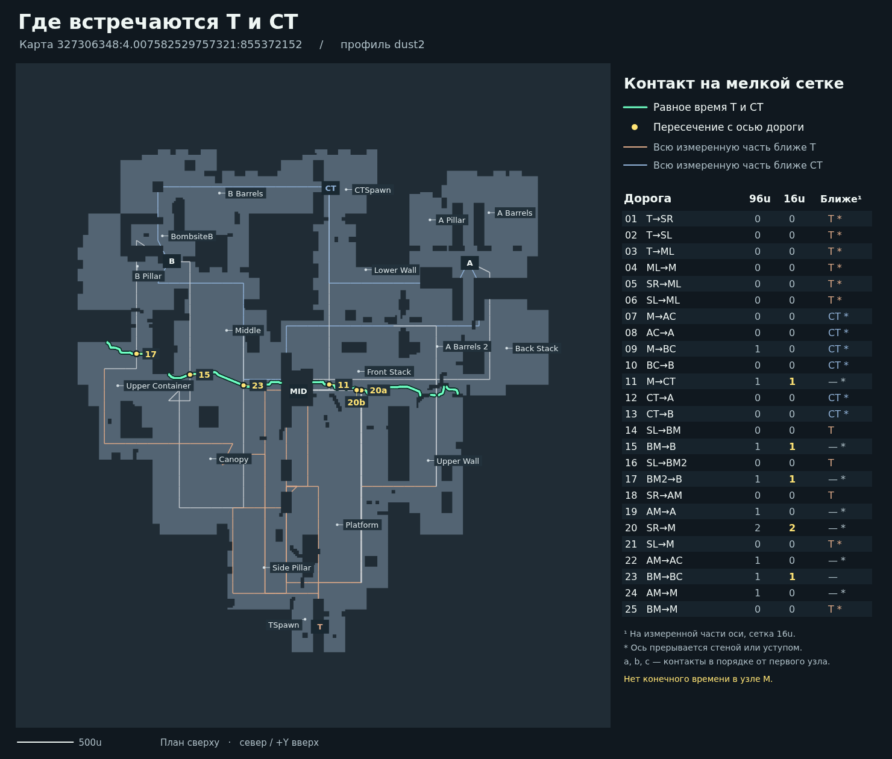
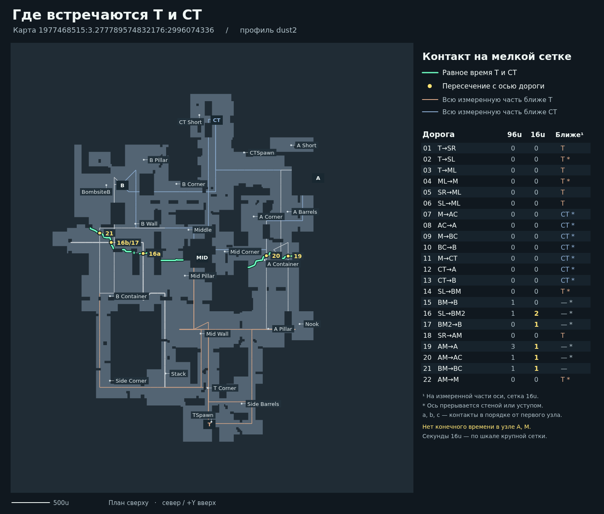
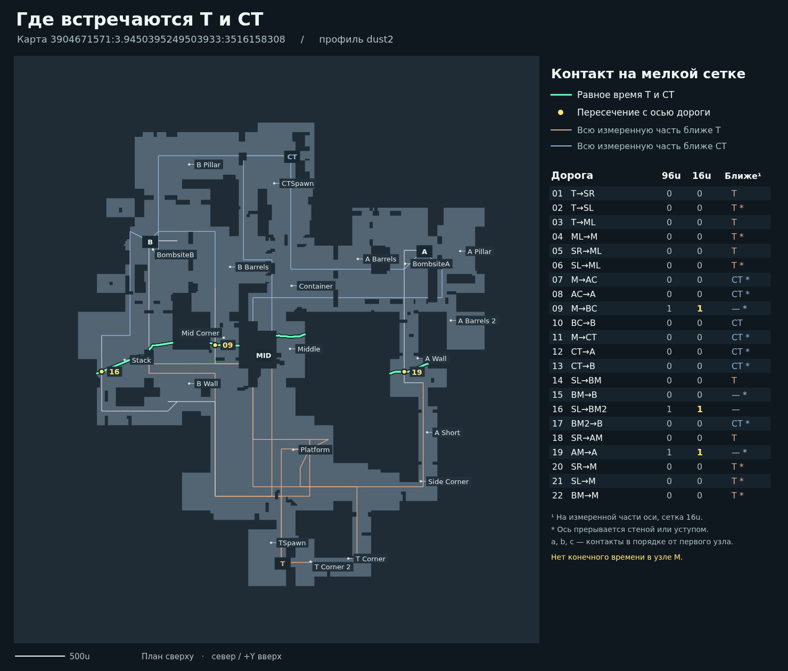
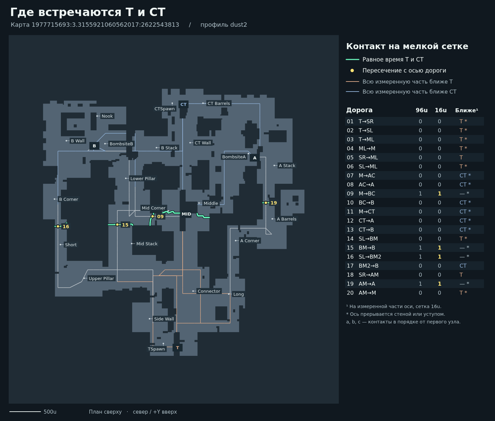
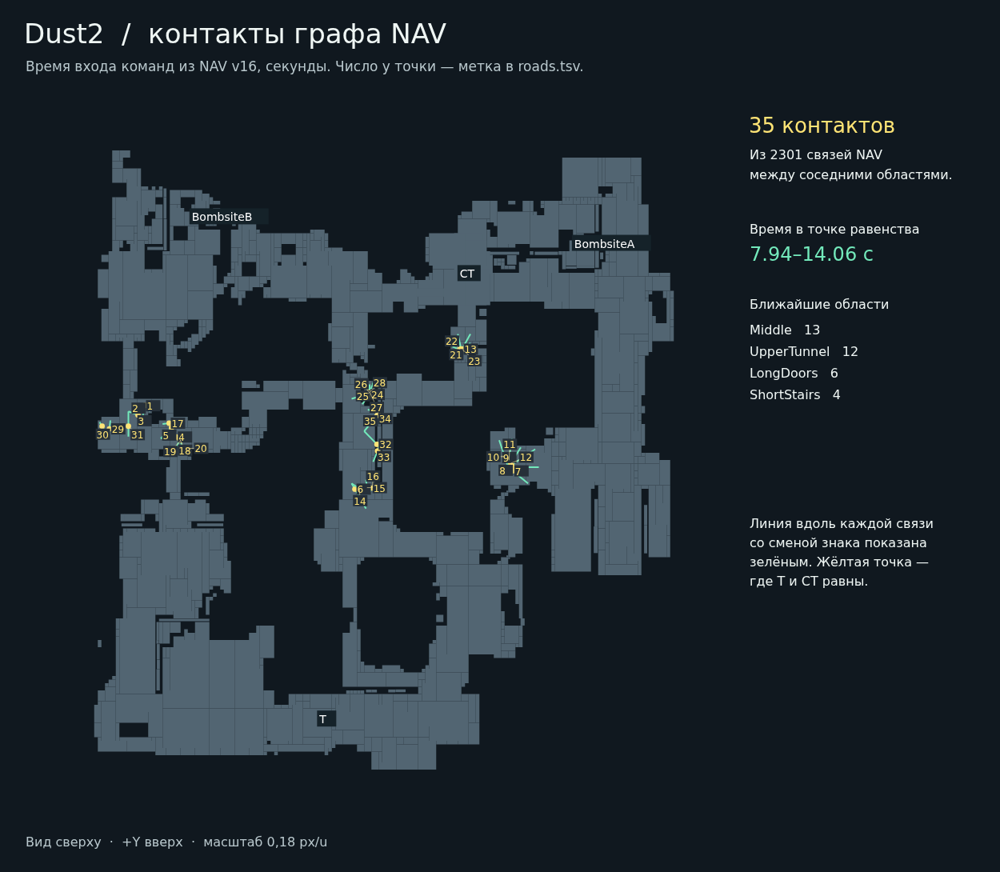
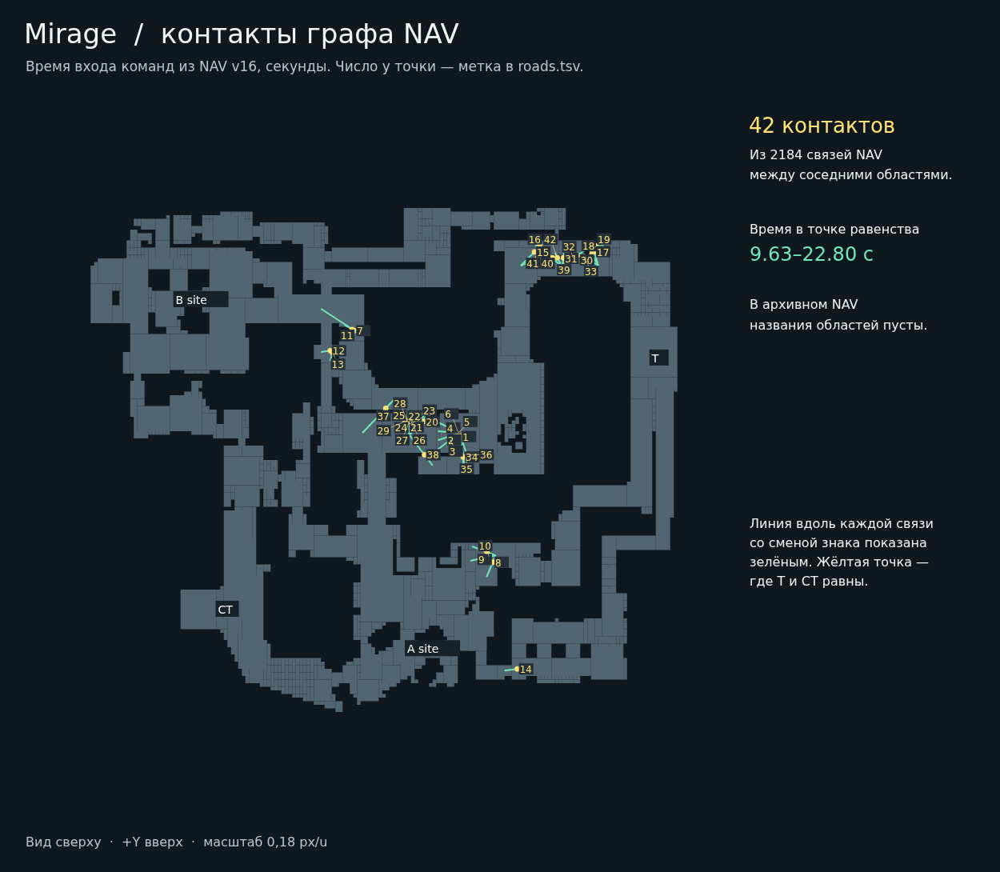

# Где встречаются T и CT

Зелёная линия показывает места, куда T и CT одновременно успевают по расчёту. Жёлтые точки отмечают пересечения этой линии с дорогами. На всех четырёх картах Изохроны одинаковый масштаб.

[Схемы и варианты архитектуры](https://github.com/depthd/izohrona/blob/arch-research/docs/arch-research.md) · [Памятка и проверка команд](https://github.com/depthd/izohrona/tree/agents-md/docs/agents-md)

## Карта 1

Номер `327306348:4.007582529757321:855372152`. Пересечений с дорогами на мелкой сетке — 6, на крупной — 10.



[Время и точки каждой дороги](card-1/roads.tsv) · [Сдвиг между сетками](card-1/shift.tsv) · [Сверка A, B и мида](card-1/measure.tsv)

## Карта 2

Номер `1977468515:3.277789574832176:2996074336`. Пересечений с дорогами на мелкой сетке — 6, на крупной — 7.



[Время и точки каждой дороги](card-2/roads.tsv) · [Сдвиг между сетками](card-2/shift.tsv) · [Сверка A, B и мида](card-2/measure.tsv)

## Карта 3

Номер `3904671571:3.9450395249503933:3516158308`. Пересечений с дорогами на мелкой сетке — 3, на крупной — 3.



[Время и точки каждой дороги](card-3/roads.tsv) · [Сдвиг между сетками](card-3/shift.tsv) · [Сверка A, B и мида](card-3/measure.tsv)

## Дополнительная карта из свежего прогона

Номер `1977715693:3.3155921060562017:2622543813`. Пересечений с дорогами на мелкой сетке — 4, на крупной — 4.



[Время и точки каждой дороги](card-4/roads.tsv) · [Сдвиг между сетками](card-4/shift.tsv) · [Сверка A, B и мида](card-4/measure.tsv)

## Dust2 и Mirage

Для этих двух карт использованы времена движения команд из архивных файлов навигации. Их шкала времени отличается от шкалы Изохроны. В архиве Mirage у областей нет названий.

### Dust2

На связях между соседними областями отмечено 35 пересечений. Время встречи составляет 7,94–14,06 с.



[Связи и времена](dust2/roads.tsv) · [Исходные параметры замера](dust2/summary.json)

### Mirage

На связях между соседними областями отмечено 42 пересечений. Время встречи составляет 9,63–22,80 с.



[Связи и времена](mirage/roads.tsv) · [Исходные параметры замера](mirage/summary.json)

## Что подтвердили проверки

- Три VMF совпали с исходными файлами до байта. Гейт по тем же картам остался красным из-за слишком узких проходов (33 при пороге 0). [Сверка VMF](replay-verification.txt) · [Гейт](fixed-gate.txt) · [Повтор карт](povtor.txt)
- 19 контрольных значений на A, B и в миде совпали с цифрами генератора. На двух картах генератор не дал конечного времени до мида на мелкой сетке. На второй карте он не вернул мелкий замер из-за недостижимого A, поэтому для её плана использованы штатные поля `refineFields()` и шкала крупной сетки. [Таблицы четырёх карт](generated.tsv)
- Сдвиг 17 сопоставленных точек между крупной и мелкой сетками составил 5,4–244,8 юнита. Семь точек есть только на крупной сетке, две — только на мелкой. Первый визуальный контакт зависит также от видимости.

## Как повторить

Из корня проекта с установленными Playwright и Chromium.

```sh
node tools/kontakt.js 327306348:4.007582529757321:855372152 1977468515:3.277789574832176:2996074336 3904671571:3.9450395249503933:3516158308 1977715693:3.3155921060562017:2622543813
node tools/kontakt.js --etalon
```

[Код прибора](../../tools/kontakt.js)
